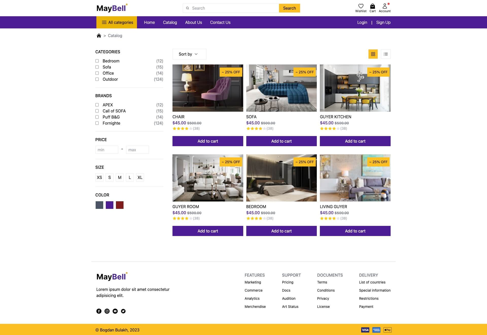
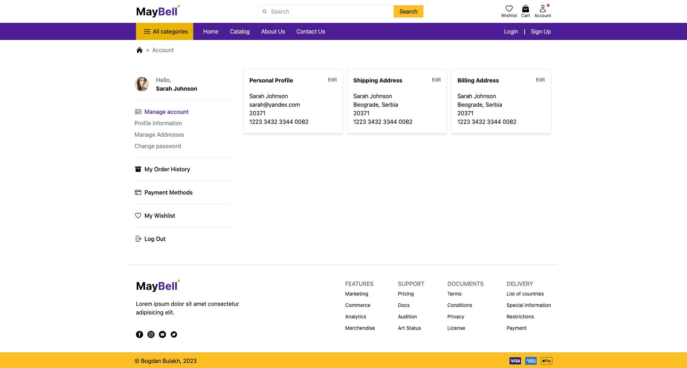
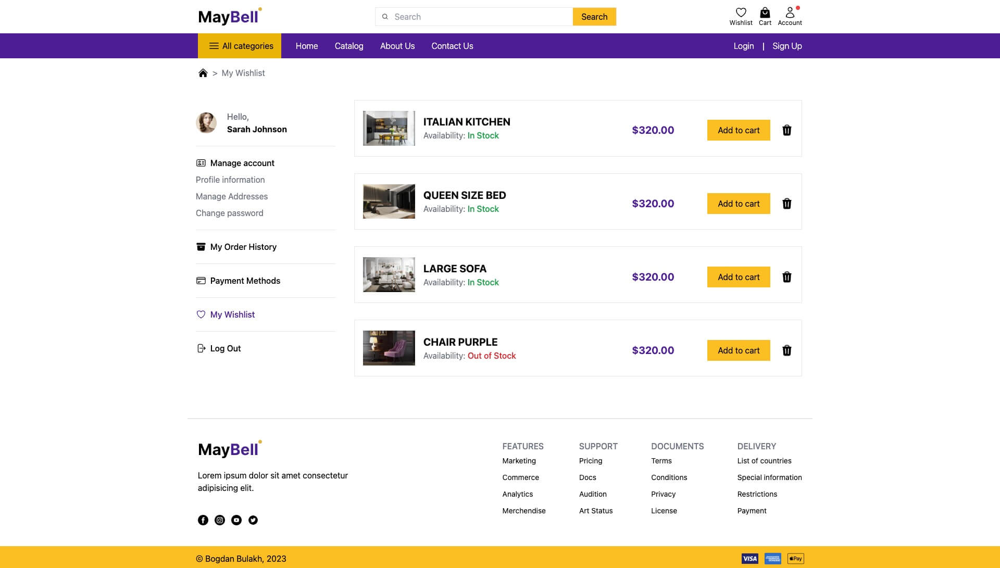

# Tailwind E-commerce

A collection of free E-commerce website page templates, built with the utility-first Tailwind CSS framework.<br>
MIT licensed - free for personal and commercial use.

## Templates Preview

<details open="true"><summary><strong>Homepage</strong></summary><br>

</details>

<details><summary><strong>Catalog</strong></summary><br>

</details>

<details><summary><strong>Product overview</strong></summary><br>

</details>

<details><summary><strong>Account page</strong></summary><br>

</details>

<details><summary><strong>Wishlist</strong></summary><br>

</details>

## Getting started

Requirements: Node.js 22.23.4 or newer and pnpm 12.15.0 (pinned in `package.json`).

```sh
git clone https://github.com/bbulakh/tailwind-ecommerce.git
cd tailwind-ecommerce
pnpm install
pnpm dev
```

Open http://localhost:4321. `pnpm start` also starts the development server.

```sh
pnpm check    # Check Astro templates and TypeScript
pnpm build    # Generate the static site in dist/
pnpm preview  # Preview the production build locally
```

## Project structure

- `src/pages/`: the 21 Astro page templates.
- `src/layouts/Layout.astro`: shared HTML head, global styles, and client script.
- `src/assets/css/tailwind-ecommerce.css`: Tailwind CSS 4 and global styles.
- `src/assets/js/script.js`: Alpine.js, input masks, and Splide sliders.
- `public/`: images, favicons, and the web manifest, copied directly to the build.

Astro generates static HTML with the existing `.html` URLs (for example,
`/catalog.html`). Tailwind runs through the official `@tailwindcss/vite` plugin;
no Tailwind JavaScript config or PostCSS config is required.

## Live demo
Check the live demo here: [https://tailwind-ecommerce-demo.vercel.app/](https://tailwind-ecommerce-demo.vercel.app/)

## License
[The MIT License (MIT)](https://github.com/bbulakh/tailwind-ecommerce/blob/main/LICENSE)
